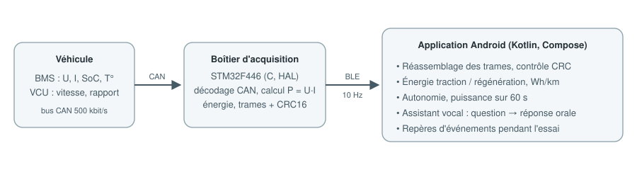
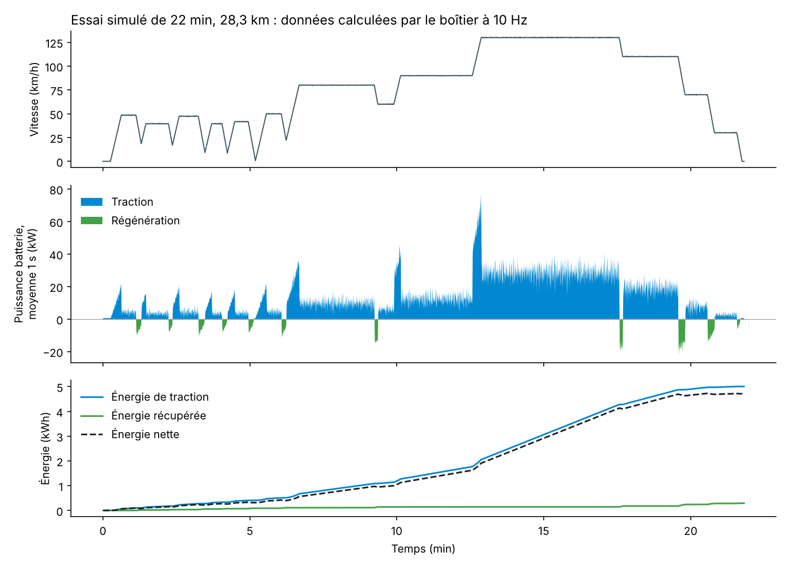

# EV Test Copilot

**Assistant d'essais pour véhicule électrique : bus CAN, boîtier embarqué STM32, liaison Bluetooth et application Android (Kotlin, Jetpack Compose) avec calcul énergétique en temps réel et assistant vocal.**

Pendant un essai sur route, l'ingénieur ne peut pas lire un ordinateur portable. Le boîtier écoute le bus CAN du véhicule, calcule la puissance et l'énergie, et envoie les données au téléphone. L'application affiche la consommation, la récupération au freinage et l'autonomie. Elle répond aussi à des questions posées à voix haute, par exemple « quelle est la consommation ? », et permet de marquer un événement sans lâcher le volant.



## Résultats sur un essai simulé

Un simulateur physique produit 22 minutes de conduite (ville, route, autoroute, 28,3 km) sous forme de journal CAN réel au format `candump` : 78 555 trames. Ce journal est rejoué à travers le **même code C** que celui du firmware.

| Grandeur | Vérité du simulateur (50 Hz) | Calcul du boîtier (10 Hz) | Écart |
|---|---|---|---|
| Énergie nette consommée | 4 708 Wh | 4 712 Wh | **+0,08 %** |
| Consommation | 166,2 Wh/km | 166,3 Wh/km | +0,08 % |
| Distance | 28,334 km | 28,334 km | < 0,01 % |
| Énergie de traction | 5 023 Wh | 5 005 Wh | −0,4 % |
| Énergie récupérée | 315 Wh | 293 Wh | −6,8 % |

L'écart sur l'énergie récupérée vient de l'échantillonnage à 10 Hz, qui lisse les pics de freinage très courts. Le bilan net, qui sert à la consommation et à l'autonomie, reste juste à 0,1 % près. L'application Android refait le même calcul à partir des trames Bluetooth et retrouve exactement les valeurs du boîtier (test `EnergyMeterTest`).



## Ce que fait chaque partie

**Bus CAN et base DBC** (`tools/ev_test.dbc`)
- `BMS_Pack` (0x3D5) : tension, courant signé, état de charge, température maximale des cellules.
- `VCU_Speed` (0x217) : vitesse véhicule et rapport engagé.

**Cœur C partagé** (`core/evtc.c`), compilé à la fois pour le microcontrôleur et pour le PC
- Décodage des trames CAN selon la DBC.
- Calcul de la puissance batterie P = U × I et intégration par la méthode des trapèzes. Le trapèze est coupé au passage par zéro, sinon la traction et la régénération se compensent et l'énergie récupérée est sous-estimée.
- Les trous de données de plus de 2 s ne sont pas intégrés.
- Trames Bluetooth de 20 octets avec CRC16-CCITT : un échantillon toutes les 100 ms et un bilan énergétique toutes les secondes, soit 220 octets/s (23 % d'une liaison à 9 600 bauds).

**Firmware du boîtier** (`firmware/`), NUCLEO-F446RE, C et HAL STM32
- CAN1 à 500 kbit/s en mode **écoute seule** : le boîtier n'émet jamais sur le bus du véhicule.
- Filtre matériel sur les deux identifiants utiles ; interruption de réception.
- Données marquées « périmées » si le CAN se tait plus de 500 ms ; aucune intégration dans ce cas.
- Envoi vers le module BLE HM-10 (USART1) et journal sur le port COM du ST-LINK (USART2).
- 11 Ko de Flash, 2,8 Ko de RAM.

**Application Android** (`android/`), Kotlin, Jetpack Compose, minSdk 26
- Liaison Bluetooth Low Energy avec le HM-10 (service 0xFFE0), réassemblage des trames découpées par le Bluetooth et contrôle CRC.
- Tableau de bord : vitesse, puissance en traction (bleu) ou en régénération (vert), batterie, Wh/km, autonomie, bilan énergétique, courbe de puissance sur 60 s.
- Assistant vocal : reconnaissance vocale d'Android en français, reconnaissance d'intention **locale** (aucune connexion nécessaire en essai), réponse courte lue à voix haute. Intentions : consommation, énergie, récupération, autonomie, puissance, batterie, température, vitesse, distance, bilan et marquage d'événement.
- Mode **Démo** : rejoue l'essai enregistré (accéléré 4 fois) pour tester l'application sans véhicule ni boîtier.

## Lancer le projet

```bash
pip install -r requirements.txt
make test        # simulateur, rejeu par le code C, tests C et tests Python
make figures     # docs/essai_energie.png
make firmware    # nécessite arm-none-eabi-gcc ; récupère la HAL ST à une version figée
make android     # nécessite le SDK Android et Java 17
```

À chaque envoi sur GitHub, l'intégration continue (`.github/workflows/ci.yml`) :
1. lance les tests C et Python ;
2. compile le firmware ;
3. lance les tests unitaires Kotlin et compile l'application ;
4. publie l'**APK** et le binaire du firmware dans l'onglet *Actions*.

### Matériel pour un essai réel

| Élément | Rôle |
|---|---|
| NUCLEO-F446RE | Boîtier d'acquisition |
| Transceiver CAN 3,3 V (SN65HVD230) | Raccordement au bus CAN, sur PA11 et PA12 |
| Module BLE HM-10 | Liaison avec le téléphone, sur PA9 et PA10 à 9 600 bauds |
| Téléphone Android 8.0 ou plus | Application et assistant vocal |

Les identifiants CAN et les échelles sont ceux de la DBC du projet. Sur un véhicule réel, il suffit de remplacer la DBC et les constantes de `core/evtc.h` par celles du constructeur.

## Tests

| Suite | Contenu |
|---|---|
| `tests/test_core.c` | CRC de référence, décodage CAN, découpage au passage par zéro, trames |
| `tests/test_pipeline.py` | Trame encodée avec **cantools** depuis la DBC, puis décodée par le code C ; CRC de toutes les trames ; énergie comparée à la vérité du simulateur |
| `android/app/src/test` | Décodage des 14 402 trames de démo, flux Bluetooth découpé et bruité, calcul énergétique identique au boîtier, compréhension des questions en français |

## État du projet

- Les données véhicule viennent d'un **simulateur** ; le journal CAN a le format réel de `candump` (SocketCAN), donc un enregistrement réel peut le remplacer directement.
- Le firmware est compilé et dimensionné, mais **pas encore flashé** sur une carte.
- L'application est compilée et testée par l'intégration continue ; elle n'a **pas encore été essayée dans un véhicule**.

## Structure

```
core/        code C commun : décodage CAN, énergie, trames Bluetooth
firmware/    boîtier STM32F446 (HAL, CAN, UART)
tools/       base DBC, simulateur d'essai, outil de rejeu, figures
tests/       tests C et Python
android/     application Kotlin et Jetpack Compose
docs/        schéma d'architecture et figure de l'essai
```
